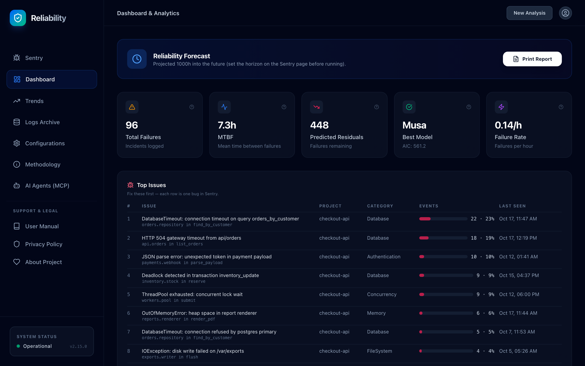
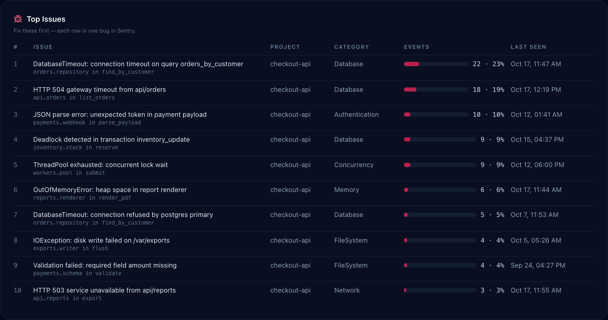
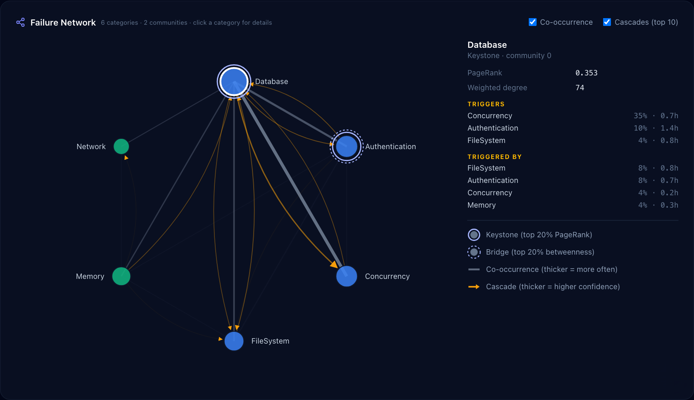
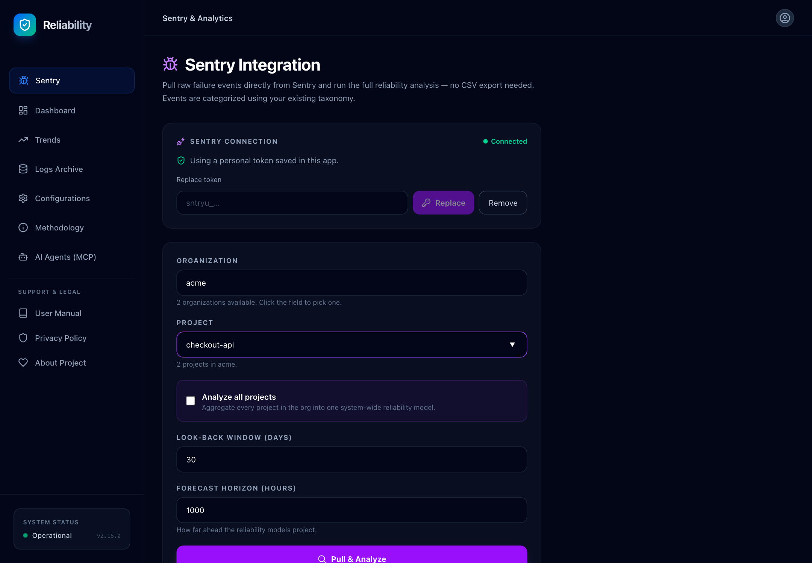
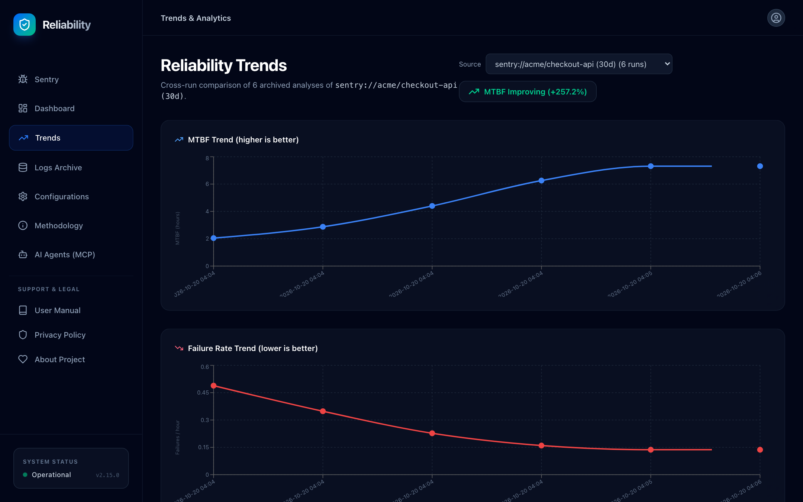
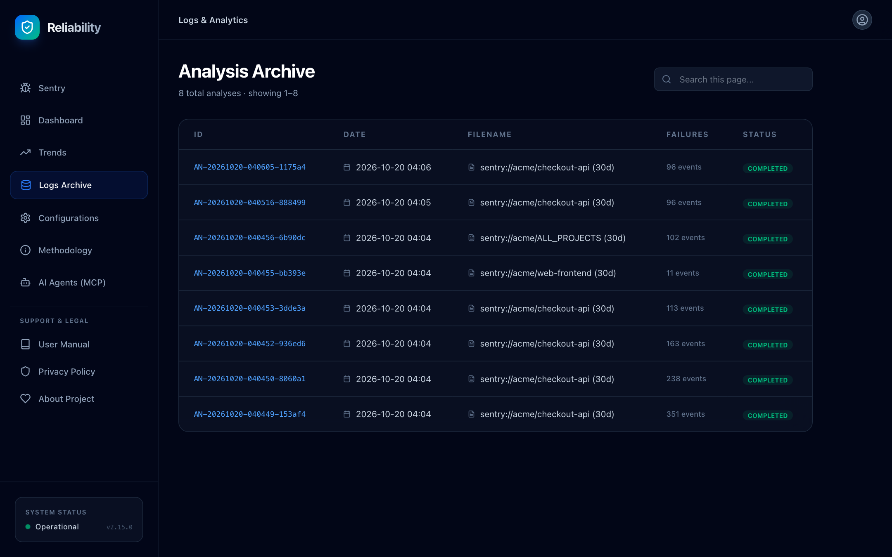
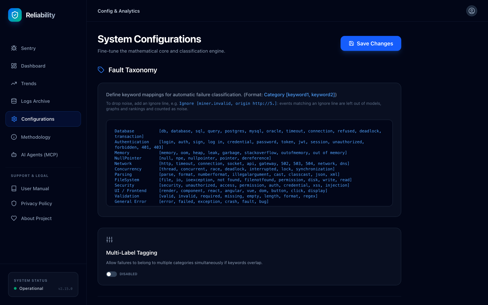
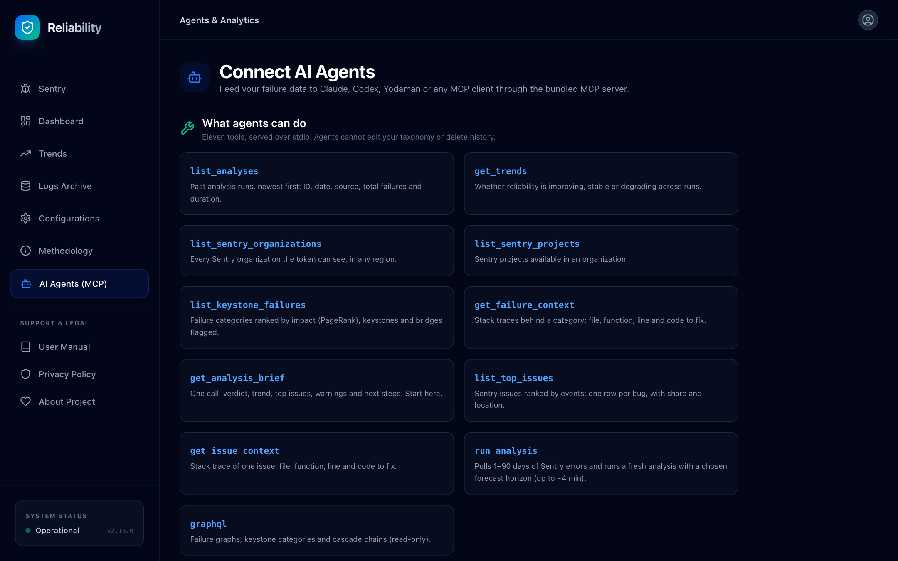
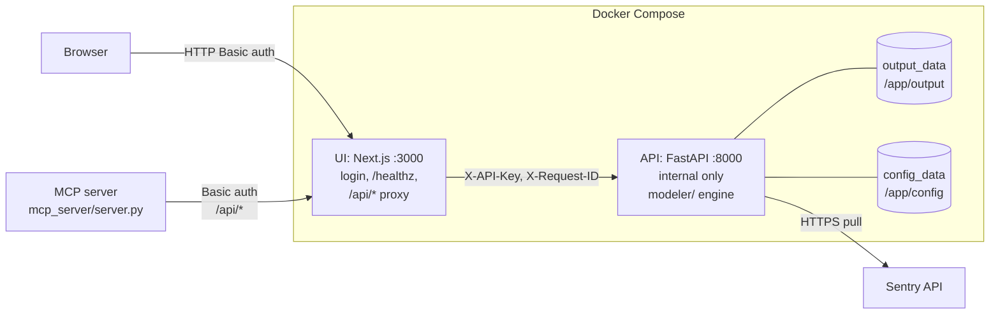

# Reliability Modeler

Turn the errors you already collect in Sentry into reliability forecasts: MTBF, remaining faults and the failure patterns that drive them.

[](CHANGELOG.md)
[](LICENSE)
[](https://hub.docker.com/r/trustaldo/reliability-modeler-api)
[](https://www.python.org/)
[](https://nextjs.org/)



> **Internal network only.** Run it behind your network boundary or VPN. It has authentication, but it is not hardened as an internet-facing service.
>
> **Data source: Sentry only.** There is no CSV upload, file import or CLI.

## Key capabilities

**Reliability modelling**
- Fits Goel-Okumoto (GO) and Musa-Okumoto (MO) NHPP models by maximum likelihood.
- Reports AIC, parameters and expected total failures per model; the Dashboard picks the best (lowest AIC).
- Dashboard KPIs: total failures, MTBF, failure rate, predicted residual faults, best model.
- Projects cumulative failures and failure intensity over a forecast horizon you choose (1 to 100,000 hours).
- Refuses to report an impossible fit: no growth, too little data, or a boundary optimum gives "No model could be fitted".

**Failure graph analytics**
- Co-occurrence and cascade graphs over fault categories (NetworkX).
- Keystone categories (top 20% PageRank) and bridge categories (top 20% betweenness).
- Recurring cascade chains with occurrence count, latency and confidence.
- Louvain communities, graph density and plain-language insights.
- Cross-analysis view of categories that are keystone most often.
- Top Issues: failures ranked by Sentry issue (one row per bug) with share, location, burst flag and a Sentry link, plus warnings when the taxonomy is too coarse or one bug dominates the model.
- `Ignore [...]` taxonomy rules leave bot probes and other noise out of models and rankings.
- Interactive failure-network view on the Dashboard: categories sized by PageRank, coloured by community, with co-occurrence links and cascade arrows; click a category to see what it triggers and what triggers it.

**Sentry ingestion**
- Pull 1 to 90 days of events from one project, or aggregate every project in an org.
- Keyword taxonomy assigns each event a fault category (single- or multi-label).
- Per-project and system-wide breakdowns; MTBF and failure-rate trends per source.

**AI agents via MCP**
- Stdio MCP server with eleven tools for Claude Code, Codex, Claude Desktop and other MCP clients.
- Uses the UI login from the repo `.env`, so no secret goes into agent configs.

**Operations**
- Docker Compose deployment; only the UI port is published.
- Health, readiness and Prometheus metrics; request IDs on every response.
- Automatic retention pruning, volume backup and restore scripts, smoke test.
- Multi-arch images (`linux/amd64`, `linux/arm64`) on Docker Hub.

## Screenshots

<table>
  <tr>
    <td width="50%"><br><sub><b>Top issues</b>: one row per Sentry issue: share of failures, culprit, last seen, burst flag and Sentry link. Fix from the top.</sub></td>
    <td width="50%"><br><sub><b>Failure network</b>: keystones, bridges, co-occurrence and cascades; click a category for its triggers.</sub></td>
  </tr>
  <tr>
    <td width="50%"><br><sub><b>Run an analysis</b>: connect Sentry once, pick any organization and project (or all projects), look-back window, forecast horizon.</sub></td>
    <td width="50%"><br><sub><b>Reliability trends</b>: MTBF and failure rate per source across runs.</sub></td>
  </tr>
  <tr>
    <td width="50%"><br><sub><b>Analysis archive</b>: every completed run, searchable and paginated.</sub></td>
    <td width="50%"><br><sub><b>Taxonomy and settings</b>: fault categories, Ignore rules for noise, multi-label tagging, solver settings.</sub></td>
  </tr>
  <tr>
    <td width="50%"><br><sub><b>Connect AI agents</b>: copyable MCP setup for Claude Code, Codex and other clients.</sub></td>
    <td width="50%"></td>
  </tr>
</table>

## Quick start

Requirements: Docker Engine 24+ with the Compose plugin, and at least 1 vCPU.

```bash
cp .env.example .env
chmod 600 .env
```

Set these keys in `.env`:

| Key | How to get it |
|-----|---------------|
| `RELIABILITY_API_KEY` | `openssl rand -hex 32` (required) |
| `UI_PASSWORD` | `openssl rand -base64 24` (required) |
| `SENTRY_AUTH_TOKEN` | Optional. You can instead connect a token on the Sentry page of the UI |

```bash
docker compose up -d
docker compose ps        # both services should become "healthy"
```

Open **http://localhost:3000** and sign in with `UI_USERNAME` (default `admin`) and `UI_PASSWORD`. Go to **Sentry**, enter your org and project, then **Pull & Analyze**.

`docker compose` refuses to start if `RELIABILITY_API_KEY` or `UI_PASSWORD` is missing. Pin a release with `IMAGE_TAG=2.15.0` in `.env`.

## Architecture



| Layer | Location | Purpose |
|-------|----------|---------|
| UI | `web/ui` | Next.js 16 frontend, Basic-auth login, server-side proxy to the API |
| API | `web/api` | FastAPI: Sentry ingestion, analysis, GraphQL, reports, health, metrics |
| Engine | `modeler/` | NHPP models, categorisation, graph analytics, Sentry connector, plots |
| MCP server | `mcp_server/` | Exposes the running stack to AI agents over stdio |

The browser never sees the API key; the UI proxy injects it server-side. Port 8000 is not published to the host.

### UI views

| Sidebar tab | Shows |
|-------------|-------|
| Sentry | Analysis form: org, project or "Analyze all projects", look-back (1-90 days), forecast horizon (hours) |
| Dashboard | KPIs, model comparison, reliability forecast, intensity, categories, MTBF trend, heatmap, risk landscape, fault network, project breakdown, recent events, Print Report |
| Trends | MTBF and failure-rate charts per source, with a source selector and improving/stable/degrading verdict |
| Logs Archive | Paginated, searchable list of archived runs |
| Configurations | Fault taxonomy editor, multi-label tagging, optimisation method, tolerance |
| Methodology | GO and MO formulas, AIC and residuals explained |
| AI Agents (MCP) | Install, register and credential steps for MCP clients |
| User Manual, Privacy Policy, About Project | Reference pages |

A system status badge polls `/api/health` and shows Operational, Degraded, Error or API unreachable.

## How it works

| Step | What happens |
|------|--------------|
| 1. Ingest | Pulls events newest-first, 100 per page, up to 50 pages (5,000 events) per project. Retries 429/5xx with backoff. |
| 2. Categorise | Matches event title, exception type, release and environment against `fault_categories.conf` keywords. No match gives `Uncategorized`. |
| 3. Fit models | GO profiles out `a` and solves `b` with a bounded 1-D search. MO profiles out theta and searches with the configured solver. |
| 4. Graph analytics | Builds co-occurrence and cascade graphs (2 h window, min co-occurrence 3). Needs at least 5 events. |
| 5. Archive | Stores the run summary, categorised events and reliability plot under `OUTPUT_DIR`. Returns an ID like `AN-20261016-142233-a1b2c3`. |

**No-fit rules.** A model is not reported when there are fewer than 3 events, the time span is zero, the mean event time is at least half the window (no reliability growth), or the optimum sits on the search boundary. `models` may then be empty.

**Event cap and `truncated`.** With `project: "all"`, up to 50 projects are analysed. If any project hit its 5,000-event cap, every project is trimmed to a common start so the merged timeline is not skewed, and the response carries `truncated: true`. The Dashboard shows a warning.

**Timeouts.** The Sentry fetch and the analysis each have `ANALYSIS_TIMEOUT_SECONDS`. A timed-out analysis stops and is not archived.

## Configuration

Every variable is documented in [`.env.example`](.env.example).

| Variable | Default | Required | Purpose |
|----------|---------|----------|---------|
| `RELIABILITY_API_KEY` | none | **yes** | Shared secret between UI proxy and API (`X-API-Key`) |
| `UI_PASSWORD` | none | **yes** | UI login password; empty gives 503 on every UI route |
| `SENTRY_AUTH_TOKEN` | empty | no | Personal (`sntryu_`) or integration token with `event:read`, `project:read`, `org:read`. Overrides a token connected in the UI. With neither, `/health` is `degraded` |
| `SENTRY_BASE_URL` | `https://sentry.io/api/0/` | no | Self-hosted Sentry only. sentry.io organizations in any region (US, EU) are found automatically |
| `UI_USERNAME` | `admin` | no | UI login username |
| `UI_PORT` | `3000` | no | Host port for the UI |
| `PROXY_TIMEOUT_MS` | `250000` | no | UI to API proxy timeout |
| `TRUST_PROXY` | `false` | no | `true` only behind a reverse proxy that sets `X-Forwarded-For` |
| `ALLOWED_ORIGINS` | `http://localhost:3000` | no | CORS origins, only for direct browser calls to the API |
| `LOG_LEVEL` | `INFO` | no | `DEBUG`, `INFO`, `WARNING`, `ERROR` |
| `RETENTION_DAYS` | `90` | no | Prune archives, analyses and plots at startup and daily; `0` disables |
| `ANALYSIS_TIMEOUT_SECONDS` | `120` | no | Max seconds for the Sentry fetch and for the analysis |
| `MAX_BODY_BYTES` | `1048576` | no | API request body limit |
| `RATE_LIMIT_PER_MINUTE` | `30` | no | API requests per minute per client IP |
| `API_CPUS` / `UI_CPUS` | `1` / `1` | no | CPU limit per container; keep at or below `nproc` |
| `API_MEMORY` / `UI_MEMORY` | `1g` / `512m` | no | Memory limit per container |
| `IMAGE_TAG` | `latest` | no | Image tag to run; pin in production, change to roll back |
| `DOCKERHUB_NAMESPACE` | `trustaldo` | no | Image namespace to pull from |
| `ALLOW_INSECURE_NO_AUTH` | `false` | no | Local dev only: API starts without a key. Not passed by compose |
| `UI_AUTH_DISABLED` | `false` | no | Local dev only: UI skips login. Not passed by compose |

Set by the API image, not by `.env`: `CONFIG_DIR=/app/config`, `OUTPUT_DIR=/app/output`, `DEFAULT_CONFIG_PATH=/app/defaults/fault_categories.conf`. Outside Docker they default to the repo root, `./output` and `./fault_categories.conf`. Compose also fixes the UI's `API_URL` to `http://api:8000`.

`make push` does not read `.env`; pass the namespace on the command line: `make push DOCKERHUB_USERNAME=<you>`.

## API reference

The browser and MCP server reach these routes as `/api/<path>` through the UI proxy. Errors are JSON `{"detail": "..."}`. Every response carries `X-Request-ID`.

| Method | Path | Auth | Purpose |
|--------|------|------|---------|
| GET | `/health/live` | none | Liveness: `{"status":"ok"}` (not rate limited) |
| GET | `/health` | none | Readiness: `ok`, `degraded` or `error` (503), with checks and version |
| GET | `/metrics` | API key | Prometheus metrics (`rm_http_requests_total`, `rm_analyses_total`, ...) |
| POST | `/ingest/sentry` | API key | Pull events and run the analysis. Body: `org`, `project` (or `all`), `days` (1-90, default 30), `future_hours` (1-100000, default 1000) |
| GET | `/ingest/sentry/organizations` | API key | Every Sentry org the token can see (slug, name, region) |
| GET | `/ingest/sentry/projects?org=` | API key | List projects in a Sentry org |
| GET | `/config` | API key | Fault taxonomy and engine settings |
| POST | `/config` | API key | Update taxonomy (`content`) and/or `settings` |
| GET | `/config/sentry` | API key | Whether a Sentry token is connected, its source (`environment`, `ui`, `none`) and type. Never returns the token |
| POST | `/config/sentry` | API key | `{"token": "..."}` checks the token with Sentry and saves it (mode 0600 in `config_data`); `{"token": ""}` removes it. 409 when `SENTRY_AUTH_TOKEN` is set |
| GET | `/logs?limit=&offset=` | API key | Paginated archive, newest first (limit 1-200) |
| POST | `/logs/prune?retention_days=` | API key | Delete archived files older than N days (minimum 7) |
| GET | `/trends` | API key | Cross-run MTBF and failure-rate trends, grouped per source (`groups`) |
| GET | `/report/{id}/html` | API key | Self-contained, print-ready HTML report for one run |
| GET | `/analyses/{id}/brief` | API key | One-call summary for agents: verdict, trend, top issues, keystones, warnings, next steps |
| GET | `/analyses/{id}/issues?limit=` | API key | Sentry issues of the run ranked by event count (share, culprit, location, burst, Sentry link) |
| GET | `/analyses/{id}/issues/{group_id}/context` | API key | Live stack trace of an issue's latest event |
| GET | `/analyses/{id}/context?category=&limit=` | API key | Live stack-trace context for up to 5 recent events in a category (`id` may be `latest`). No local variables, request or user data |
| POST | `/graphql` | API key | Failure-graph queries over archived analyses |
| GET | `/docs`, `/redoc`, `/openapi.json` | API key | Interactive API docs |

`/ingest/sentry` returns `id`, `summary`, `future_hours`, `models`, `plots` (base64 PNG), `categorized_failures` (newest 100), `categorized_total`, `graph_insights`, `graph_report`, `truncated`, and `projects` for an org-wide run.

### GraphQL

| Query | Returns |
|-------|---------|
| `availableAnalyses` | Analysis IDs available for graph queries |
| `failureGraph(analysisId, cascadeWindowHours, minCooccurrence)` | `graphMetrics`, `centralityScores`, `cascadeChains`, `communities`, `cooccurrenceEdges`, `graphJson` |
| `keystoneCategories(analysisId, limit)` | Categories ranked by PageRank, with `isKeystone` and `isBridge` |
| `cascadeChains(analysisId, limit)` | `chain`, `occurrenceCount`, `avgLatencyHours`, `confidence` |
| `keystoneCategoriesAcross(limit)` | `keystoneCount` and `avgPagerank` across the 50 most recent analyses |

```graphql
{ keystoneCategories(analysisId: "AN-20261016-142233-a1b2c3") { node pagerank isBridge } }
```

Limits: 256 KB per query, depth 8, at most 10 graph-building fields per request, introspection disabled.

## AI agents (MCP)

`mcp_server/server.py` is a stdio MCP server that calls the running stack through the UI proxy.

| Tool | Returns |
|------|---------|
| `list_analyses(limit, offset)` | Archived runs, newest first |
| `get_trends()` | MTBF and failure-rate trends per source |
| `list_sentry_organizations()` | Every Sentry org the token can see, across regions |
| `list_keystone_failures(analysis_id, limit)` | Categories ranked by PageRank, keystone and bridge flags (default: newest analysis) |
| `get_analysis_brief(analysis_id)` | One call: failures, MTBF, best model, trend, top issues, keystones, warnings, next steps (default: newest analysis). Start here |
| `list_top_issues(analysis_id, limit)` | Sentry issues ranked by events: share, culprit, location, burst flag, Sentry link |
| `get_issue_context(group_id, analysis_id)` | Stack trace of an issue's latest event: exception, top frames with file/function/line/code |
| `get_failure_context(category, analysis_id, limit)` | Stack traces behind a category: exception, culprit, release, top frames with file/function/line/code, Sentry link |
| `list_sentry_projects(org)` | Projects in a Sentry org |
| `run_analysis(org, project, days, future_hours)` | A fresh analysis (up to about 4 minutes); plots stripped |
| `graphql(query)` | Read-only failure-graph queries |

Setup, credentials (`RM_URL`, `RM_USERNAME`, `RM_PASSWORD`, `RM_API_KEY`) and client registration: [`mcp_server/README.md`](mcp_server/README.md).

## Development

Python 3.13 and Node 22, matching the images.

```bash
# Python
python3.13 -m venv .venv && source .venv/bin/activate
pip install -r requirements-dev.txt

# API
cd web/api
RELIABILITY_API_KEY=dev-key uvicorn main:app --reload --port 8000

# UI (second terminal)
cd web/ui && npm ci
API_URL=http://127.0.0.1:8000 RELIABILITY_API_KEY=dev-key UI_PASSWORD=dev npm run dev
# open http://localhost:3000 (admin / dev)
```

| Tests | Command |
|-------|---------|
| Python unit (with coverage) | `make test-python` |
| API integration (API running) | `python -m pytest tests/integration` |
| UI | `cd web/ui && npm test` (also `npm run lint`, `npm run typecheck`) |
| MCP server | `cd mcp_server && .venv/bin/python -m pytest -q test_server.py` |

| Make target | Does |
|-------------|------|
| `make help` / `make version` | List targets / print version |
| `make test` | Python unit tests with coverage, then UI tests |
| `make build` | Build both images locally, tagged `:<VERSION>` |
| `make smoke` | Smoke-test the built images in a throwaway compose project |
| `make push` | Multi-arch build and push `:<VERSION>` and `:latest` (asks to confirm) |
| `make up` / `make down` / `make logs` | Run, stop (volumes kept) and follow the stack |
| `make backup` / `make restore FILE=...` | Back up or restore the data volumes |
| `make clean` | Remove local images and caches |

## Operations

| Topic | Where |
|-------|-------|
| Deploy, upgrade, rollback, secret rotation, incidents | [`RUNBOOK.md`](RUNBOOK.md) |
| Health, metrics, logging, troubleshooting, capacity | [`SUPPORT.md`](SUPPORT.md) |
| End-user guide | [`USER_MANUAL.md`](USER_MANUAL.md) |
| Release notes | [`CHANGELOG.md`](CHANGELOG.md) |

**Backups.** `scripts/backup.sh` archives `output_data` and `config_data` into a timestamped `.tar.gz` (mode 0600). `scripts/restore.sh` verifies the archive before replacing volumes; stop the stack first.

**CI.** `.github/workflows/test.yml` runs on pushes and PRs to `main`: unit tests (75% coverage floor), MCP tests, API integration tests, UI lint/typecheck/test/build, `npm audit`, `pip-audit`, Docker build and smoke test.

**Releases.** `.github/workflows/release.yml` publishes multi-arch images to Docker Hub. It runs only from `main` or a `v*` tag matching `__version__` in `modeler/__init__.py`, after the full test suite passes.

## Security notes

| Area | Behaviour |
|------|-----------|
| UI | HTTP Basic auth on every route except `/healthz`; constant-time credential checks |
| API | `X-API-Key` on every route except `/health` and `/health/live`, including docs and metrics. Refuses to start without a key |
| Network | Only the UI port is published; the API is reachable on the compose network only |
| Secrets | The API key stays server-side in the UI proxy; it never reaches the browser |
| Rate limiting | Per client IP on the API. Client `X-Forwarded-For` is ignored unless `TRUST_PROXY=true` |
| Body limits | UI proxy: 1 MiB, and chunked POSTs without `Content-Length` get 411. API: `MAX_BODY_BYTES` |
| Proxy methods | Only `GET` and `POST` are forwarded |
| Containers | `no-new-privileges`, all capabilities dropped, non-root API user |

The API key is a shared secret on a trusted network, not a per-user identity. Rotate it as described in the runbook.

## Ownership

| Role | Contact |
|------|---------|
| Service owner | Marwa Trust Mutemasango |
| Team channel | trustaldo@gmail.com |
| Escalation | trustaldo@gmail.com |
| Repository | https://github.com/Yoda-Man/reliability-modeler |

## License

MIT, see [`LICENSE`](LICENSE).
